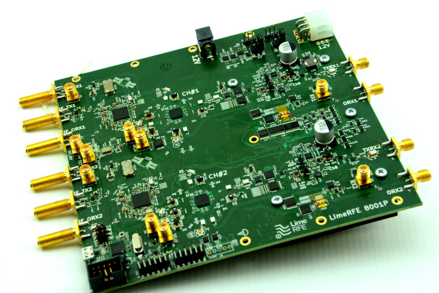

Introduction
############

.. toctree::
   :maxdepth: 2
   :hidden:

   Introduction <self>
   user/index
   reference/index

LimeRFE 8001P board is a two channel RF front end module capable of frequency conversion, RF signal Amplification and Power Amplifier linearization. Both internal (on board) driver amplifiers and external (off board) amplifiers can be linearized.  

Specifications
**************

.. _absolute-maximum-ratings:

Absolute maximum ratings
========================

.. list-table:: Maximum input signals for IF, RF and other AC (periodic) signal connectors 
   :header-rows: 1

   * - Connector
     - Frequency 
  
       Range
     - Designator 
      
       on the Board
     - Maximum 
      
       Allowed Input
     - Comments
   * - IFTX1
     - IF
     - J6
     - `a)` –14 dBm
       
       `b)` +6 dBm
       
       `c)` +20 dBm
     - Critical component is U121 (SC1905).
       
       `a)` When AMP1 (U93) is ON.
       
       `b)` When AMP1 (U93) is OFF and bypassed.
       
       `c)` When AMP1 (U93) is OFF and not bypassed.
   * - IFTX2
     - IF
     - J9
     - `a)` –14 dBm
       
       `b)` +6 dBm
       
       `c)` +20 dBm
     - Critical component is U131 (SC1905).
       
       `a)` When AMP2 (U106) is ON.
       
       `b)` When AMP2 (U106) is OFF and bypassed.
       
       `c)` When AMP2 (U106) is OFF and not bypassed.
   * - TXRX1
     - RF
     - J15
     - `a)` +8 dBm
     - Critical component is U46 (TSS-53LNB3+).
       
       `a)` When LNA1 (U46) is ON, RX mode.
   * - TXRX2
     - RF
     - J20
     - `a)` +8 dBm
     - Critical component is U48 (TSS-53LNB3+).
       
       `a)` When LNA2 (U48) is ON, RX mode.
   * - ORX1
     - RF
     - J4
     - `a)` +37 dBm
       
       `b)` 26 dB–XdB
     - `a)` For ORX1 Att [dB] > 23 dB, critical component is U57 
       
       (PAT3060H-C-10DB-T1).
       
       `b)` For ORX1 Att [dB] < 23 dB, critical component is U1 
       
       (LMS8001B), with 4 dBm max input power.
       
       XdB is ORX1 Att [dB] from GUI.
   * - ORX2
     - RF
     - J5
     - `a)` +37 dBm
       
       `b)` 26 dB–XdB
     - `a)` For ORX2 Att [dB] > 23 dB, critical component is U61 
      
       (PAT3060H-C-10DB-T1).
       
       `b)` For ORX2 Att [dB] < 23 dB, critical component is U2 
       
       (LMS8001B), with 4 dBm max input power.
       
       XdB is ORX2 Att [dB] from GUI.
   * - EXT_REF
     - 10 MHz reference 
      
       for off chip PLL
     - J13
     - Vpp = 3.3 V
     - Critical component is U18 (ADF4002BCPZ-RL7).
       
       Vpp: peak-to-peak value of periodic signal.
   * - EXT_LO CH#1
     - External LO reference
     - J3
     - Typ: 0 dBm
       
       Max: +3 dBm
     - Critical component is U1 (LMS8001B).
   * - EXT_LO CH#2
     - External LO reference
     - J26
     - Typ: 0 dBm
       
       Max: +3 dBm
     - Critical component is U2 (LMS8001B).
   * - IF
     - IF
     - J33
     - +4 dBm
     - Critical component is U1 (LMS8001B).
       
       Not used Channel A.
   * - RF
     - RF
     - J34
     - +4 dBm
     - Critical component is U1 (LMS8001B).
       
       Not used Channel A.
   * - RF
     - RF
     - J35
     - +4 dBm
     - Critical component is U2 (LMS8001B).
       
       Not used Channel A.
   * - IF
     - IF
     - J57
     - +4 dBm
     - Critical component is U2 (LMS8001B).
       
       Not used Channel A.
   * - I2C 5x1 pin connector
     - Digital signal
     - J1
     - 2.2 – 5.5 V
     - This is I2C connector for front panel control.
       
       Critical components are U153 and U153.
   * - SPI2 3x2 pin connector
     - Digital signal
     - J19
     - 3.3 V
     - SPI2 bus pins (SPI2 is internal board SPI bus).
       
       Critical component is U115.
   * - SPI1 PMOD connector
     - Digital signal
     - J28
     - 1.65 – 5.5 V
     - SPI1 bus pins (SPI1 is external bus for communication with other board).
       
       Critical components are U24 and U163.
   * - GPIO PMOD connector
     - Digital signal
     - J36
     - 1.65 – 5.5 V
     - Free MCU GPIO pins are connected to this connector.
       
       Critical component is U38.

Key Characteristics
===================

.. list-table:: The most important characteristics of the LimeRFE 8001P board
   :header-rows: 1

   * - Description
     - Value
     - Comments
   * - IF frequency range
     - 1.8 – 2.0 GHz
     -
   * - RF frequency range
     - 3.3 – 5.0 GHz
     -
   * - Gain – TX path IFTX1→TXRX1 connector
     - 43 – 46 dB
     - Branch A of PDA1 is active.
       
       AMP1 is active.
       
       Ch.C can variate loss 0 – 9 dB. (Default 0)
       
       TX1 Att. [dB] can variate loss 0 – 31.75 dB. (Default 0)
   * - Gain – TX path IFTX1→TXRX1 connector
     - 25 – 28 dB
     - Branch A of PDA1 is active.
       
       AMP1 is inactive.
       
       Ch.C can variate loss 0 – 9 dB. (Default 0)
       
       TX1 Att. [dB] can variate loss 0 – 31.75 dB. (Default 0)
   * - Gain – TX path IFTX2→TXRX2 connector
     - 41 – 44 dB
     - Branch B of DA1 is active.
       
       AMP1 is active.
       
       Ch.C can variate loss 0 – 9 dB. (Default 0)
       
       TX1 Att. [dB] can variate loss 0 – 31.75 dB. (Default 0)
   * - Gain – TX path IFTX2→TXRX2 connector
     - 23 – 26 dB
     - Branch B of DA1 is active.
       
       AMP1 is inactive.
       
       Ch.C can variate loss 0 – 9 dB. (Default 0)
       
       TX1 Att. [dB] can variate loss 0 – 31.75 dB. (Default 0)
   * - Gain – RX path TXRX1→IFRX1 connector
     - 5 – 7 dB
     -
   * - Gain – RX path RX1→IFRX1 connector
     - 5.5 – 7.5 dB
     -
   * - Gain – ORX path ORX1 → IFORX1
     - –17 dB
     - ORX1 Att. [dB] can variate loss 0 – 31.75 dB. (Default 0)
   * - OP1dB @ TXRX1
     - 26 dBm
     - Branch A of PDA1 is active.
   * - OP1dB @ TXRX1
     - 22 dBm
     - Branch B of PDA1 is active.

Digital Interface
=================

* USB – micro USB type B connector (CON1) or USB pin header (J29).
* SPI – SPI1 connector (J28), for control from a master control board, such as LimeSDR-PCIe-5G.
* I2C – I2C connector (J1), for front panel control.

Power Supply
============

.. list-table::
   :header-rows: 1

   * - Connector
     - Description
   * - J2
     - External 5 V power supply input for the board
   * - J27, J30, J45
     - External 12 V power supply input for the on-board DC-DC converter, which generates 5 V for the board
   * - CON1
     - USB 5 V supply (not recommended)
   * - J24
     - External 5 V power supply input for the RF devices
   * - JP1
     - Board supply source selection (12 V, USB or external 5 V)
   * - JP2
     - RF devices supply source selection (board supply, USB or external 5 V)

.. TODO: add the maximum recommended supply voltages, if available from the designers.

.. warning::
    USB cannot provide enough current for all RF devices. Use an external 5 V or 12 V power supply, see :doc:`/reference/v1.1/power`.

Environmental
=============

.. TODO: confirm the environmental ratings with the designers. These values are the same as for LimeRFE.

.. list-table:: 
   :header-rows: 1
   :stub-columns: 1

   * - Parameter
     - Value
     - Notes
   * - Operating Temperature
     - -20 °C to +70 °C
     - Commercial-grade
   * - Storage Temperature
     - -40 °C to +85 °C
     - N/A
   * - Operating Humidity
     - 10% to 90% RH  
     - Non-condensing

Mechanical
==========

Board size 157.2 x 163.3 mm and weight 304 g

Features
********

Devices
=======

* RF band, TX 

  * Amplifiers 

    * NXP’s MMZ38333B 
    * Qorvo’s QPA9122M 

  * Attenuators 

    * Fixed attenuators (Susumu’s PAT1220 series attenuators) 
    * IDT’s F1956NBGI8 digital step attenuators 

  * Filters 

    * Minicircuits’ BFCV-4085+ 3100 – 4900 MHz band pass filter 

  * RF Coupler 

    * TDK’s HHM2955A1 24 dB RF coupler 

* RF band, RX 

  * Amplifier 

    * MiniCircuits’ TSS-53LNB3+ 

  * Filters 

    * Minicircuits’ BFCV-4085+ 3100 – 4900 MHz band pass filter 

* RX band, ORX 

  * Attenuators 

    * Fixed attenuators (Susumu’s PAT3060 series attenuators) 
    * IDT’s F1956NBGI8 digital step attenuators 

* IF band, TX 

  * Amplifiers 

    * Qorvo’s TQL9063 

  * Filters 

    * TDK’s DEA161953BT-2303B1-H 1805 – 2025 MHz band pass filter 

  * Attenuators 

    * Fixed attenuators (Susumu’s PAT1220 series attenuators) 

* IF band, RX 

  * Attenuators 

    * MiniCircuits’ BFCN-1860+ 1580 – 2200 MHz band pass filte

* IF band, ORX 

  * Attenuators 

    * TDK’s DEA161953BT-2303B1-H 1805 – 2025 MHz band pass filter 

* IF band, linearization block 

  * Linearisation device 

    * SC1905 chips 
    * Couplers 
    * Minicircuits’ BDCN-7-25+ 
    * Anaren’s DC1722J5010AHF 

  * Baluns 

    * Anaren’s BD1722J50100AHF 

  * Delay line 

    * Anaren’s XDL15-2-020S 

* REF CLK block 

  * ADF4002 frequency synthesizer chip 
  * NB3H83905CMNG clock buffer 
  * 40 MHz crystal oscillator Racon RTX5032A (footprints for Racon RPT5032A and Vectron TX-801 alternatives) 

* Frequency shifter block 

  * Frequency shifter device 

    * LMS8001B chips 

* Filters 

  * MiniCircuits’ BFCN-1860+ 1580 – 2200 MHz band pass filter 
  * TDK’s DEA161953BT-2303B1-H 1805 – 2025 MHz band pass filter 

* Baluns 

  * MiniCircuits’ TC1-1-13M+ 
  * MiniCircuits’ NCR2-113+ 
  * Johanson Technology’s 5400BL15B050 

* RF Signal Switching Block 

  * Software controlled RF switches (GUI control), Skyworks’ SKY13330-397LF 
  * External signal control RF switches (for TDD operation), Skyworks’ SKY13330-397LF

Clock network
=============

* Both channels can be synchronized to internal 40 MHz crystal oscillator
* Both channels can be synchronized o an external reference signal (e.g. 10 MHz)

Linearization 
=============

* Supports linearization of amplifier devices using FDD and TDD OFDM signals with bandwidths up to 100 MHz
* Supports linearization of GaN amplifiers and amplifiers fabricated using other technologies
* Supports linearization of the on-board RF TX amplifier chain (PDA + DA)
* Supports linearization of external amplifiers connected to the TXRX connector 

RF switching
============

* TDD operation can be controlled via the GUI 
* TDD operation can also be controlled via external signals

General user inputs/outputs
===========================

* 1x GPIO header
* 4x TDD control headers
* 8x status LEDs
* 1x I2C header
* 2x SPI headers

Connectors
===========

* Micro USB type B socket (CON1) + USB pin header (J29)
* 6x SMAs for 2 channels of RF (TXRX, ORX and dedicated RX)
* 6x SMAs for 2 channels of IF (TX, RX and ORX)
* 2x SMAs for external LO input
* 1x SMA for external reference clock input
* 1x SMA for reference clock signal monitoring
 

Purchasing
**********

Please contact the `Lime Microsystems`_ for purchasing information.

Regulatory
**********

RoHS
====

This product is RoHS compliant and does not contain hazardous substances as defined by Directive 2011/65/EU.

WEEE
====

This product must be disposed of properly according to local regulations. Do not dispose of with general household waste.

RF Transmission Notice
======================

.. warning::
   Operating RF transmitting equipment may require appropriate licensing. Users are responsible for ensuring compliance with local regulations. Unauthorised transmission may result in legal penalties.

